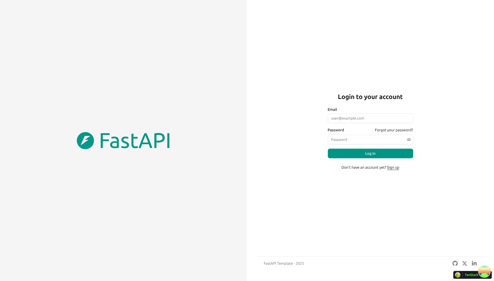
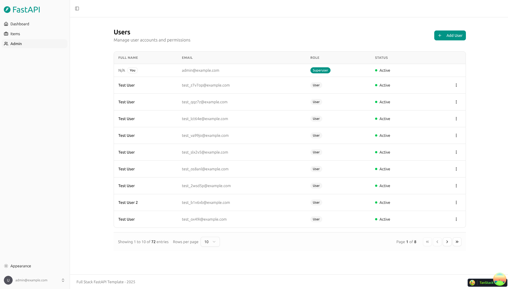
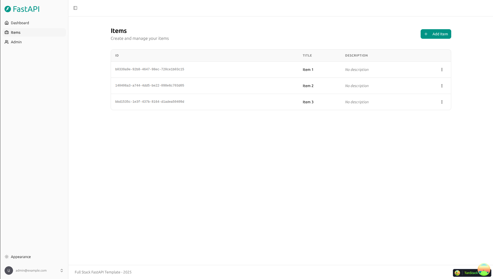
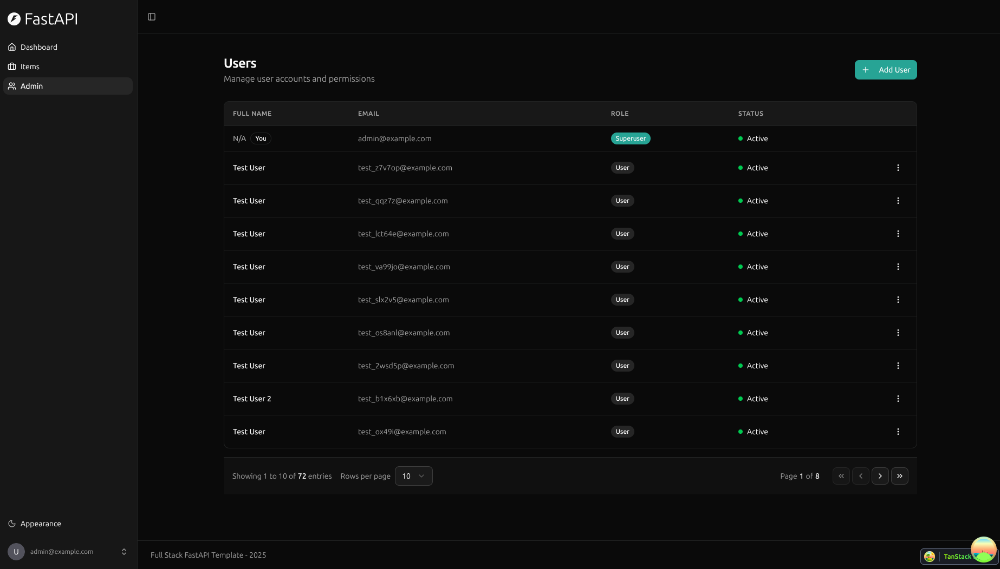
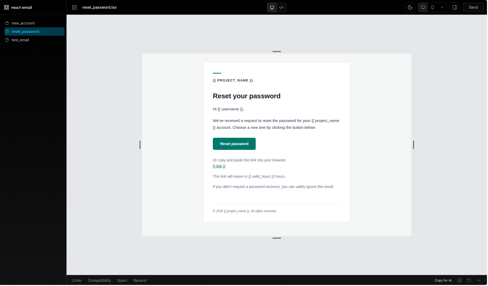
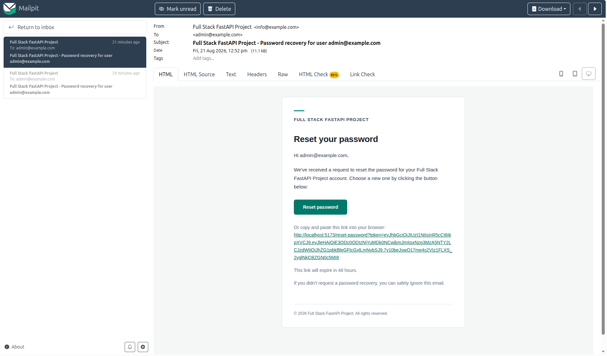
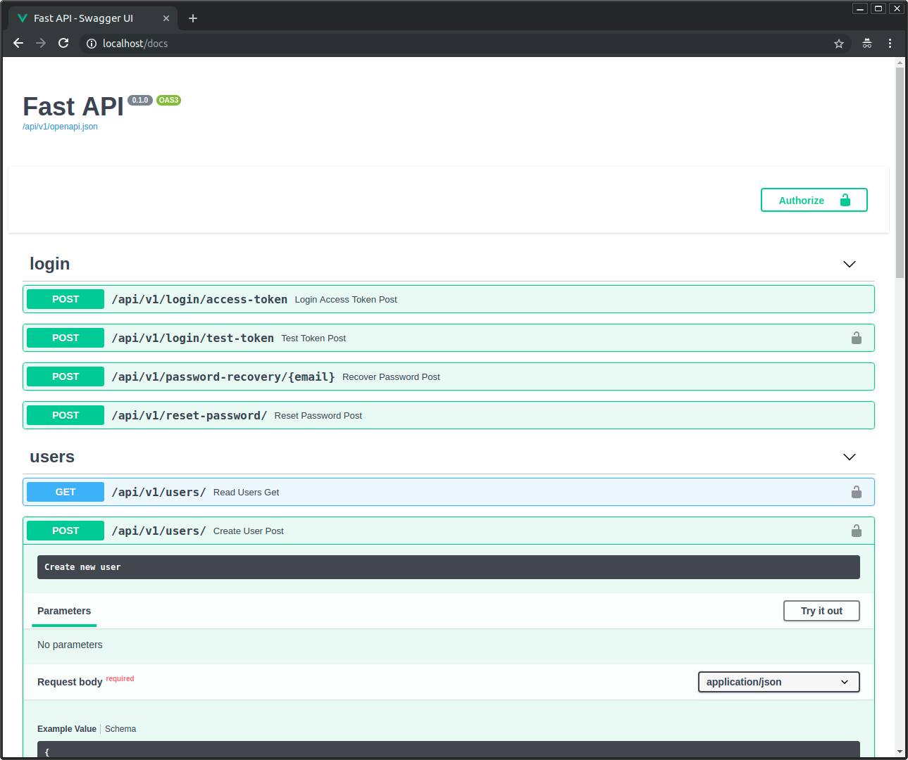

# Full Stack FastAPI 模板

## 技术栈与功能特性

- ⚡ [**FastAPI**](https://fastapi.tiangolo.com)：Python 后端 API。
  - 🧰 [SQLModel](https://sqlmodel.tiangolo.com)：Python 与 SQL 数据库的交互（ORM）。
  - 🔍 [Pydantic](https://docs.pydantic.dev)：由 FastAPI 使用，负责数据校验与配置管理。
  - 💾 [PostgreSQL](https://www.postgresql.org)：SQL 数据库。
- 🚀 [React](https://react.dev)：前端。
  - 🧩 构建产物内置于后端应用中，由 FastAPI 在与 API 相同的域名下提供服务。
  - 💃 使用 TypeScript、hooks、[Vite](https://vitejs.dev) 以及现代前端技术栈的其他部分。
  - 🎨 使用 [Tailwind CSS](https://tailwindcss.com) 和 [shadcn/ui](https://ui.shadcn.com) 构建前端组件。
  - 🤖 自动生成的前端客户端。
  - 🧪 使用 [Playwright](https://playwright.dev) 进行端到端测试。
  - 🦇 支持深色模式。
- ☁️ [FastAPI Cloud](https://fastapicloud.com)：用于部署。
- 🐋 [Docker Compose](https://www.docker.com)：用于本地服务与自托管部署。
  - 📞 [Traefik](https://traefik.io)：作为反向代理，自动处理 HTTPS。
- 🔒 默认提供安全的密码哈希。
- 🔑 JWT（JSON Web Token）认证。
- 📫 基于邮箱的密码找回。
- ✉️ [React Email](https://react.email)：邮件模板。
- 📬 [Mailpit](https://mailpit.axllent.org)：开发期间的本地邮件测试。
- ✅ 使用 [Pytest](https://pytest.org) 的测试。
- 🏭 基于 GitHub Actions 的 CI（持续集成）与 CD（持续部署）。

### 仪表盘登录

### 仪表盘 - 管理员

### 仪表盘 - 条目

### 仪表盘 - 深色模式

### React Email 模板

### Mailpit - 本地邮件测试

### 交互式 API 文档

## 如何使用

点击本页面顶部的 **Use this template**（使用此模板）按钮来创建一个新仓库。

## 后端开发

后端文档：[backend/README.md](./backend/README.md)。

## 前端开发

前端文档：[frontend/README.md](./frontend/README.md)。

## 部署

FastAPI Cloud 部署：[deployment.md](./deployment.md)。

使用 Docker Compose 的自托管部署：[deployment-docker-compose.md](./deployment-docker-compose.md)。

## 开发

通用开发文档：[development.md](./development.md)。

其中包含本地 FastAPI 与 Vite 的工作流、Docker Compose 服务、`.env` 配置等内容。

## 发布说明

查看文件 [release-notes.md](./release-notes.md)。

## 许可证

Full Stack FastAPI 模板依据 MIT 许可证条款进行授权。
